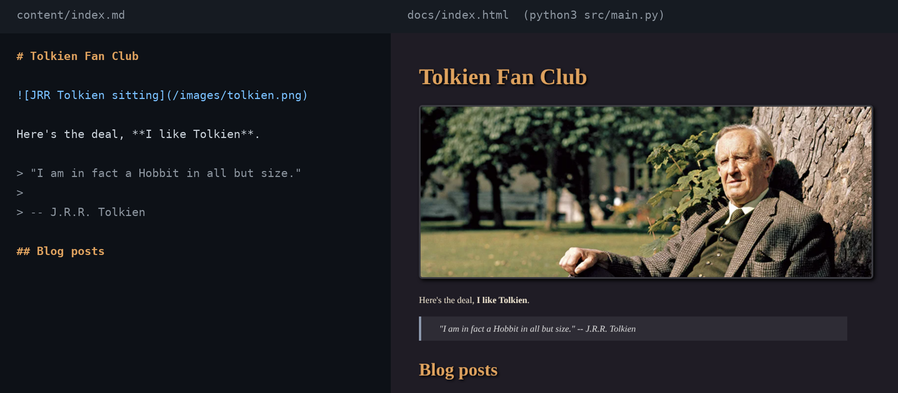

# Static Site Generator

**A static site generator in pure Python: it turns a folder of Markdown files into a folder of HTML pages, with no dependencies and no Markdown library.**
 

 
*Left: `content/index.md`. Right: the page built from it. The live result is at [amayakmt.github.io/static-site-generator](https://amayakmt.github.io/static-site-generator/).*
 
## Motivation
 
Static site generators look like magic until you write one. This one is the whole pipeline in under 400 lines: split Markdown into blocks, classify them, parse inline syntax into nodes, render the nodes as HTML, and wrap the result in a template. The parser is hand-written, and 96 unit tests cover it.
 
The demo site is a Tolkien fan page. The generator is the project.
 
## Quick Start
 
Requires **Python 3.10+** (the code uses `match`). Nothing to install.
 
```bash
git clone https://github.com/amayakmt/static-site-generator.git
cd static-site-generator
python3 src/main.py
cd docs && python3 -m http.server 8888
```
 
Open `http://localhost:8888`. The generator wipes `docs/`, copies `static/` into it, and renders every `.md` file under `content/` through `template.html`.
 
## Usage
 
### Add a page
 
Every page needs an H1 on its own line. It becomes the `<title>`.
 
```text
content/
  index.md              ->  docs/index.html
  contact/index.md      ->  docs/contact/index.html
  blog/tom/index.md     ->  docs/blog/tom/index.html
```
 
Files in `static/` (CSS, images) are copied to `docs/` unchanged. Edit `template.html` to change the layout: `{{ Title }}` and `{{ Content }}` are replaced per page.
 
### Supported Markdown
 
| Block | Syntax |
| --- | --- |
| Headings | `#` to `######` followed by a space |
| Paragraphs | Text separated by blank lines |
| Code blocks | A fence on its own line (no language tag), closed by a fence |
| Quotes | Lines starting with `>` |
| Unordered lists | Lines starting with `- ` |
| Ordered lists | `1. `, `2. `, in sequence |
 
| Inline | Syntax |
| --- | --- |
| Bold | `**text**` |
| Italic | `_text_` |
| Code | `` `text` `` |
| Links | `[text](url)` |
| Images | `` |
 
Not supported: nested lists, nested inline formatting, HTML escaping, tables, and `*italic*`.
 
### Deploy to GitHub Pages
 
Pages serves from a subpath, so root-relative links need a prefix. Pass the base path as the only argument:
 
```bash
python3 src/main.py "/static-site-generator/"
```
 
That rewrites every `href="/` and `src="/` in the output. `build.sh` runs exactly this. Commit `docs/` and set Pages to serve from `main` / `docs`.
 
### Limits to know before you write content
 
These are real behaviors, checked against the code:
 
- **Underscores are always italics.** `my_file_name.py` renders as `my<i>file</i>name.py`, and underscores inside URLs break the link.
- **A blank line inside a code block splits it**, and the generator fails with an unbalanced-delimiter error.
- **Text is not escaped.** `<` and `&` pass through as written, which also lets you embed raw HTML.
- **Pages without an H1 raise `ValueError: title not found`.**
## Contributing
 
### Clone the repo
 
```bash
git clone https://github.com/amayakmt/static-site-generator.git
cd static-site-generator
```
 
### Run the tests
 
```bash
./test.sh
```
 
This runs `python3 -m unittest discover -s src`.
 
### How the pipeline fits together
 
```text
src/
  main.py               # Entry point: clean docs/, copy static/, render content/
  generate_page.py      # Title extraction, template fill, recursive page build
  split_blocks.py       # Markdown -> blocks, block type detection
  md_to_html.py         # Blocks -> HTML node tree
  convert_raw.py        # Inline text -> TextNodes (bold, italic, code, links, images)
  extract_md_objects.py # Regex extraction for links and images
  textnode.py           # TextNode and its HTML conversion
  htmlnode.py           # HTMLNode, LeafNode, ParentNode
  copy_static.py        # Recursive copy of static/
  test_*.py             # Unit tests, one file per module
```
 
### Submit a pull request
 
Fork the repository and open a pull request to `main` with a focused change and a test for it.
 
## License
 
[MIT](LICENSE)